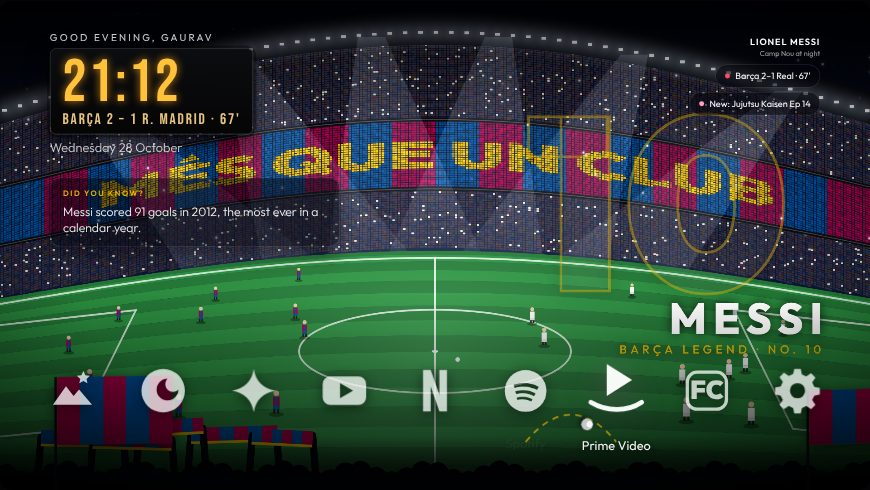
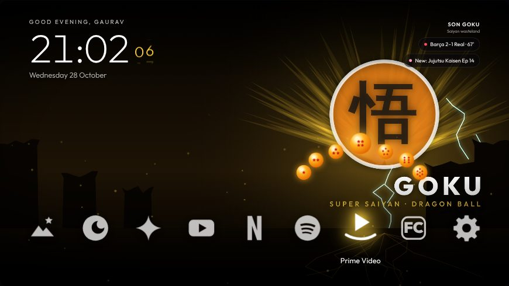
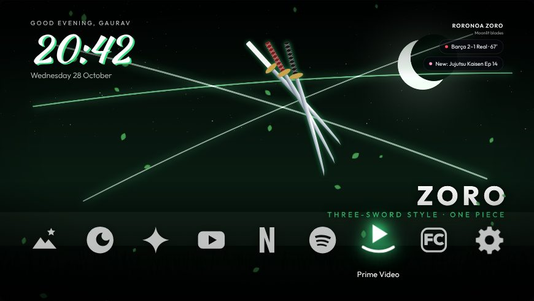

# den-tv

A home screen for Android TV that looks like *your* stuff: Camp Nou on match night, Super Saiyan
eyes that follow whatever app you select, Zoro's swords pointing the way, a Kamehameha when you need
one. Pick a look from your phone, mix your own, and let the TV switch looks by itself on match days
and new-episode nights.

|  |  |
|---|---|
| Super Saiyan: the Dragon Balls gather over the selected app | Three-Sword Style: the swords point at it |

Built on [cleanyourtv](https://github.com/Gathin23/cleanyourtv), which cleans an Android TV up safely
and replaces its ad-filled home screen. den-tv adds the looks on top.

## What works today

| Part | Status |
|---|---|
| [`themes/den-mix/`](themes/den-mix/) | **Works now.** Every scene as a wallpaper for the cleanyourtv launcher, a new one every 5 minutes |
| [`looks/`](looks/) | **Done.** 57 looks as small JSON files, the format the launcher will read |
| [`mockups/den-looks.html`](mockups/den-looks.html) | **Works now.** Open it in a browser: the full experience, with the phone settings page driving a TV preview, first-time setup with phone pairing, and live data from `fanhub/` (sample data where it can't reach the internet) |
| [`launcher/`](launcher/DEN.md) | **v1.0.** cleanyourtv's launcher with den-tv's looks: a Looks tile, the den-mix wallpapers built in, every watcher, clock and icon styles, icon layouts, wake, focus and app-opening animations, moments, a screensaver, and the Fan Hub add-on with live matches, form and standings, new episodes and the phone app. Install steps for a Vu 4K Google TV in [launcher/DEN.md](launcher/DEN.md) |
| Phone settings page served by the TV | Planned |
| [`fanhub/`](fanhub/) | **Works now.** Real fixtures, results, the La Liga table, anime episode dates and the hike forecast; `node fanhub/cli.js` prints them. Live in-match scores need two free keys |

## Set up a TV

Follow [PROMPT.md](PROMPT.md). It works on Android TV and Google TV sets (Xiaomi, TCL, Sony, Hisense,
OnePlus, Nvidia Shield and most others), not on Samsung, LG or Fire TV.

## The looks

| Category | Looks |
|---|---|
| Football | Camp Nou Nights, GOAT, Albiceleste, El Clásico Eve, Floodlights |
| Cricket | Wankhede Roar, Hitman, King Kohli, Chase Master, Blue Billion |
| Heroes | Hero Wall, Super Saiyan, Ultra Instinct, Prince of Saiyans, Nine-Tails, Sage Mode, Copy Ninja, Crow Genjutsu, Avenger, Humanity's Strongest, Bankai, Arise, One Punch, Set Your Heart Ablaze, King of Curses, Straw Hat, Three-Sword Style, Navigator, Butterfly Mansion |
| One Piece | Gear 5, Wanted, King of Hell, Lost Again, Fire Fist, ROOM, Black Leg, Hana Hana, Drum Island |
| Anime | Crimson Moon, Domain Expansion, Grand Line, Water Breathing, Manga Panel, Anime Dusk |
| Outdoors | Trail Dawn, Sahyadri Monsoon |
| Night & neon | Neon Tokyo |
| Seasonal | Diwali Night |
| Together | Our Wall, Seoul Nights, Bollywood Marquee |
| After dark | Noir, Velvet Night, High Roller, Midnight Lounge |
| Geek & code | Geek HUD, Coder |

Each look picks a scene, a hero, a watcher, a focus effect, a wake animation, a clock, extras and a
big moment from one shared library. On top of any look you can switch on widgets: a "Did you know?" facts card or ticker about the heroes in the look, and a next-match countdown. App icons have 13 styles (Dragon Balls, Wanted posters, manga ink, neon, jersey patches and more) and 7 layouts (a football formation, a cricket field, a bookshelf, a big carousel and more), with live badges, smart order, a folder that unrolls like a scroll, and your own names and pictures. The Fan Hub opens from its dock tile in whichever look is on. [looks/README.md](looks/README.md) lists every option.

## Your own characters

Make a character with an AI image tool and upload it on the phone page: den-tv makes its eyes follow
the selected app, blink, tilt and walk. See [docs/make-a-character.md](docs/make-a-character.md).

## Your pictures

Everything in this repo is drawn in code, so it can be shared. Player photos and official artwork
belong to their photographers and studios: put them on your own TV, but don't commit them here.

## Licence

MIT. See [LICENSE](LICENSE) and [NOTICE.md](NOTICE.md) for what comes from cleanyourtv.
