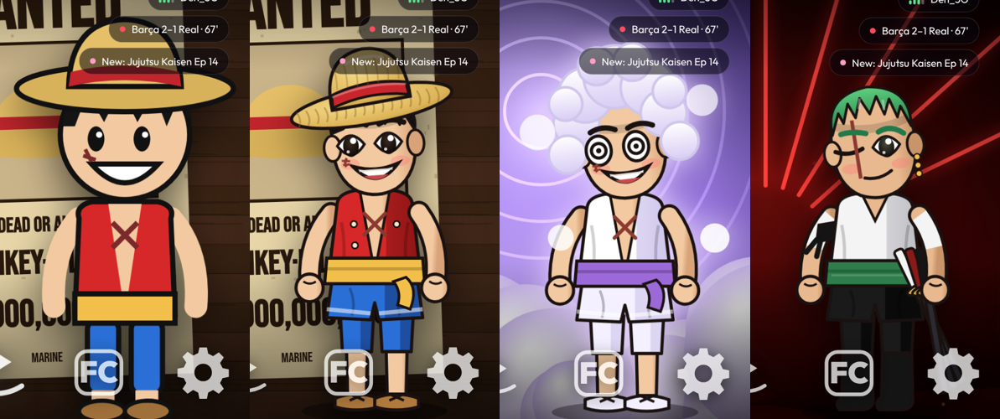

# Making the art better

The scenes, posters and characters in this repo are drawn in code. That keeps them tiny, free to
share and quick on a 1 GB TV, but there is a ceiling to what hand-written vector code can look like.
These are the ways past it, from cheapest to best.

| Tier | What it is | Look | Moves? | Cost | Shareable in this repo? |
|---|---|---|---|---|---|
| 1. Detailed code art | The current "Detailed" characters: cel shading, faces with irises and highlights, blinking, head turns, swaying arms | Good cartoon | Yes | Free | Yes |
| 2. Rive characters | Characters drawn in [Rive](https://rive.app), with a state machine whose input is "where is the focused app". Eyes, head, arms and idle loops are animated by an artist; the launcher only feeds in the position | Real animation quality | Yes, smoothly, at a few hundred KB per character | An artist's time, or community files | Only with the artist's permission; fan art of studio characters stays a grey area |
| 3. Lottie animations | After Effects animations exported as JSON, played by `lottie-android` | Polished, but plays fixed clips | Clips only, so watchers are harder | An artist's time | As above |
| 4. Painted wallpapers | High-resolution art for the scenes and posters, from an artist or an image model | Best stills | No (the watchers still move on top) | Per picture | Original art only |
| 5. Your own pictures | Official wallpapers from the studios, clubs and leagues, on your own TV | Official | No | Free | No, never committed |

## Recommendation

- Keep tier 1 as the default, so every look works out of the box.
- Make the launcher able to load a Rive file per character (tier 2). The Rive Android runtime draws on
  the GPU and handles one or two characters at 1080p comfortably. Cap it at 30 fps on 1 GB TVs, and
  fall back to the code-drawn character if a file is missing.
- Let the phone page import Rive files, wallpapers and posters, so each person can upgrade the art on
  their own TV without changing the repo.

## Performance budget for art

- One full character and one walker on screen at a time.
- Wallpapers 1920×1080, under 300 KB each, decoded one at a time.
- Rive and Lottie files under 1 MB each, paused whenever an app is in front of Home.
